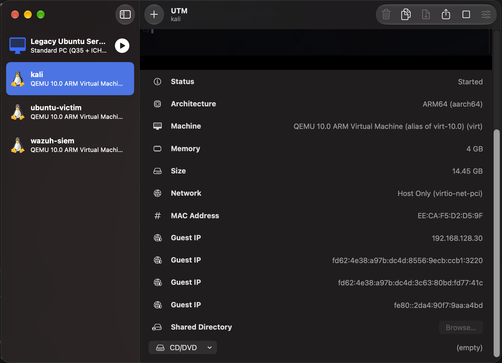
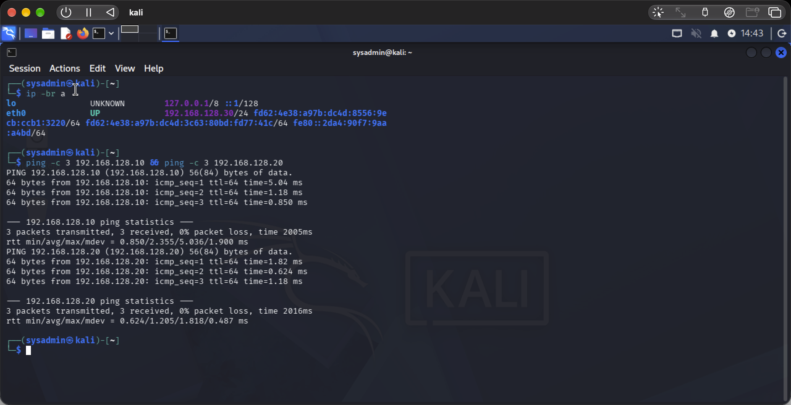
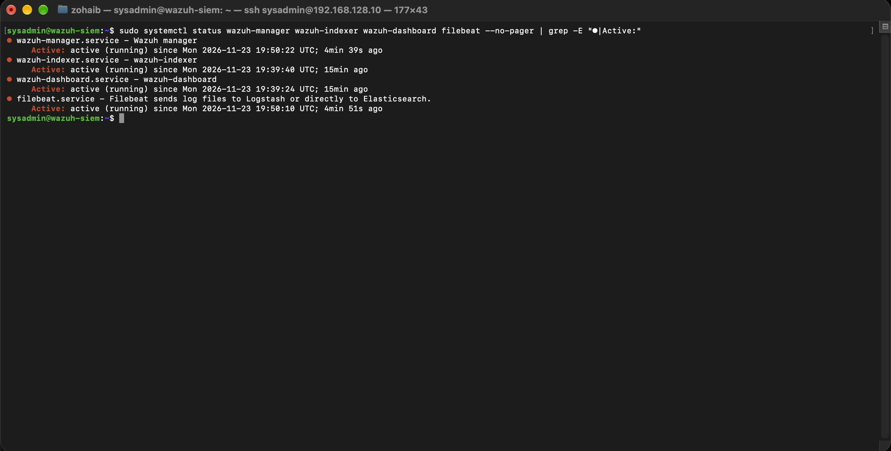

# Wazuh SOC Home Lab: Detection Engineering, Adversarial Emulation & Incident Response

-black?style=flat-square&logo=apple)
-blue?style=flat-square)


An end-to-end **Security Operations Center (SOC) & Detection Engineering Home Lab** built from scratch on native **ARM64 architecture**. This repository documents the incremental infrastructure build, operational troubleshooting, and live execution of adversarial simulations mapped to **MITRE ATT&CK** against an instrumented Linux endpoint monitored by **Wazuh SIEM**.

---

## Lab Architecture & Network Topology

All three virtual machines run natively on Apple Silicon via **UTM (QEMU 10.0 ARM)** inside an isolated **Host-Only (`192.168.128.0/24`)** virtual subnet with static IP assignments. Administrative operations for the headless Ubuntu servers are managed via **SSH** from native macOS Terminal sessions alongside the Kali Linux graphical console in a unified 2×2 SOC command layout.

```text
+-----------------------------------------------------------------------------------+
|                        macOS Host (Apple Silicon / ARM64)                         |
|   [ Native Terminal SSH Sessions ]  +  [ Safari: Wazuh Web UI (Port 443) ]        |
+-----------------------------------------+-----------------------------------------+
                                          |
                          Isolated Host-Only Virtual Switch
                                 (192.168.128.0/24)
                                          |
          +-------------------------------+-------------------------------+
          |                               |                               |
          v                               v                               v
+-------------------+           +-------------------+           +-------------------+
|    wazuh-siem     |           |   ubuntu-victim   |           |       kali        |
|  192.168.128.10   | <======== |  192.168.128.20   | <======== |  192.168.128.30   |
|  Ubuntu 24.04.5   |  TCP/1514 |  Ubuntu 24.04.5   |  SSH/22   |  Kali Linux       |
|  (ARM64 / SSH)    |  Agent    |  (ARM64 / SSH)    |  Attack   |  (ARM64 / GUI)    |
+-------------------+  Telemetry+-------------------+  Traffic  +-------------------+
```

---

## Virtual Machine Inventory

| Hostname | Role | OS/Architecture | IP Address | Management & Key Services |
| :--- | :--- | :--- | :--- | :--- | 
| `wazuh-siem` | SIEM Manager, Indexer, & Dashboard | Ubuntu Server 24.04.5 LTS (ARM64) | `192.168.128.10` | SSH (`22`), Wazuh Manager (`1514/1515`), Filebeat, Web UI (`443`) |
| `ubuntu-victim` | Monitored Enterprise Endpoint | Ubuntu Server 24.04.5 LTS (ARM64) | `192.168.128.20` | SSH (`22`), Wazuh Agent `v4.14.10` |
| `kali` | Adversary Emulation Node | Kali Linux (ARM64) | `192.168.128.30` | Graphical Console (`virtio-gpu`), Nmap, THC-Hydra | 

---

## Lab Progress Log

### Phase 1A: Infrastructure Provisioning, Troubleshooting, & Telemetry Baseline 
1. **Isolated ARM64 Virtualization & Network Configuration**
- Provisioned all three VMs on native `aarch64` images in UTM using a **Host-Only** (`virtio-net-pci`) switch (`192.168.128.0/24`) with static Netplan addressing (see configs/50-cloud-init.yaml).
- Engineering Notes: Bypassed an initial AR64 graphical installer hangup on Kali Linux via a temporary UTM serial console fallback, and resolved Xfce display profile snapping conflicts (`Connecting Displays: Do nothing`) so `spice-vdagent` scales Kali cleanly into 1/4 screen quadrant alongside active macOS Terminal SSH sessions.

   

   

2. **Wazuh SIEM Stack & Endpoint Agent Enrollment**
- Deployed the Wazuh `v4.14.10` All-in-One stack on wazuh-siem (`.10`), confirming all four core services (`wazuh-manager`, `wazuh-indexer`, `wazuh-dashboard`, and `filebeat`) are active and healthy. 
- Enrolled `ubuntu-victim` (`.20`) over `TCP/1514` and verified active heartbeat telemetry in the Wazuh Endpoints dashboard.

   

   

   

---

## Upcoming Phases

- **Phase 1B:** Network Reconnaissance (`Nmap`) & SSH Brute-Force Emulation (`THC-Hydra`/`MITRE T1110.001`)
- **Phase 2:** Automated Incident Response & Active Containment (`firewall-drop`)
- **Phase 3:** Real-Time File Integrity Monitoring (`Syscheck` + `auditd`/`MITRE T1565.001`)
- **Phase 4:** Custom XML Detection Rule Engineering & Privilege Escalation (`MITRE T1548.003`)