# Wazuh SOC Home Lab: Detection Engineering, Adversarial Emulation & Incident Response

-black?style=flat-square&logo=apple)
-blue?style=flat-square)


An end-to-end **Security Operations Center (SOC) & Detection Engineering Home Lab** built from scratch on native **ARM64 architecture**. This repository documents the incremental infrastructure build, operational troubleshooting, and live execution of adversarial simulations mapped to **MITRE ATT&CK** against an instrumented Linux endpoint monitored by **Wazuh SIEM**.

---

## Lab Architecture & Network Topology

All three virtual machines run natively on Apple Silicon via **UTM (QEMU 10.0 ARM)** inside an isolated **Host-Only (`192.168.128.0/24`)** virtual subnet with static IP assignments. Administrative operations for the headless Ubuntu servers are managed via **SSH** from native macOS Terminal sessions alongside the Kali Linux graphical console in a unified 2×2 SOC command layout.

```text
+-----------------------------------------------------------------------------------+
|                        macOS Host (Apple Silicon / ARM64)                         |
|   [ Native Terminal SSH Sessions ]  +  [ Safari: Wazuh Web UI (Port 443) ]        |
+-----------------------------------------+-----------------------------------------+
                                          |
                          Isolated Host-Only Virtual Switch
                                 (192.168.128.0/24)
                                          |
          +-------------------------------+-------------------------------+
          |                               |                               |
          v                               v                               v
+-------------------+           +-------------------+           +-------------------+
|    wazuh-siem     |           |   ubuntu-victim   |           |       kali        |
|  192.168.128.10   | <======== |  192.168.128.20   | <======== |  192.168.128.30   |
|  Ubuntu 24.04.5   |  TCP/1514 |  Ubuntu 24.04.5   |  SSH/22   |  Kali Linux       |
|  (ARM64 / SSH)    |  Agent    |  (ARM64 / SSH)    |  Attack   |  (ARM64 / GUI)    |
+-------------------+  Telemetry+-------------------+  Traffic  +-------------------+
```

---

## Virtual Machine Inventory

| Hostname | Role | OS/Architecture | IP Address | Management & Key Services |
| :--- | :--- | :--- | :--- | :--- | 
| `wazuh-siem` | SIEM Manager, Indexer, & Dashboard | Ubuntu Server 24.04.5 LTS (ARM64) | `192.168.128.10` | SSH (`22`), Wazuh Manager (`1514/1515`), Filebeat, Web UI (`443`) |
| `ubuntu-victim` | Monitored Enterprise Endpoint | Ubuntu Server 24.04.5 LTS (ARM64) | `192.168.128.20` | SSH (`22`), Wazuh Agent `v4.14.10` |
| `kali` | Adversary Emulation Node | Kali Linux (ARM64) | `192.168.128.30` | Graphical Console (`virtio-gpu`), Nmap, THC-Hydra | 

---

## Lab Progress Log

### Phase 1A: Infrastructure Provisioning, Troubleshooting, & Telemetry Baseline 
1. **Isolated ARM64 Virtualization & Network Configuration**

    - Provisioned all three VMs on native `aarch64` images in UTM using a **Host-Only** (`virtio-net-pci`) switch (`192.168.128.0/24`) with static Netplan addressing (see configs/50-cloud-init.yaml).
    - Engineering Notes: Bypassed an initial ARM64 graphical installer hangup on Kali Linux via a temporary UTM serial console fallback, and resolved Xfce display profile snapping conflicts (`Connecting Displays: Do nothing`) so `spice-vdagent` scales Kali cleanly into 1/4 screen quadrant alongside active macOS Terminal SSH sessions.

   

   

2. **Wazuh SIEM Stack & Endpoint Agent Enrollment**

    - Deployed the Wazuh `v4.14.10` All-in-One stack on wazuh-siem (`.10`), confirming all four core services (`wazuh-manager`, `wazuh-indexer`, `wazuh-dashboard`, and `filebeat`) are active and healthy. 
    - Enrolled `ubuntu-victim` (`.20`) over `TCP/1514` and verified active heartbeat telemetry in the Wazuh Endpoints dashboard.

   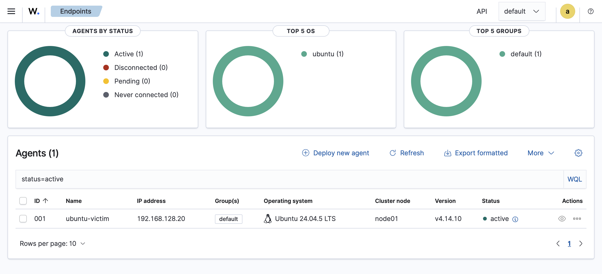

   

   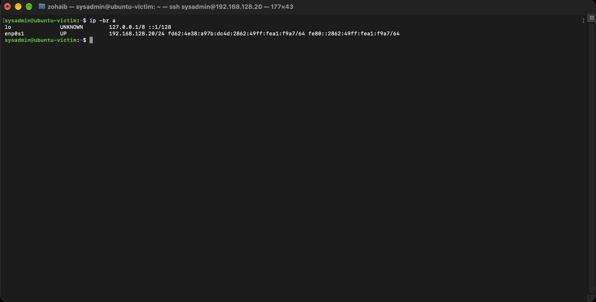

---

### Phase 1B: Network Reconnaissance & SSH Brute-Force Emulation (`MITRE T1046` / `T1110.001`)

1. **Full-Port TCP Reconnaissance (`Nmap` / `MITRE T1046`)**
   - Executed an unauthenticated full-port SYN/service scan (`nmap -n -Pn -v -T4 -sV -sC -p- 192.168.128.20`) from `kali` (`.30`), scanning all 65,535 TCP ports in `0.97s` and identifying `22/tcp` (`OpenSSH 9.6p1 Ubuntu 3ubuntu13.20`) as the sole exposed attack surface.
   - *Detection Engineering Takeaway:* Confirmed that host-based log monitoring alone does not alert on half-open TCP SYN scans because `sshd` only logs connection attempts that reach the application handshake—highlighting the operational need for network-layer IDS (e.g., Suricata/Zeek) alongside endpoint telemetry.

   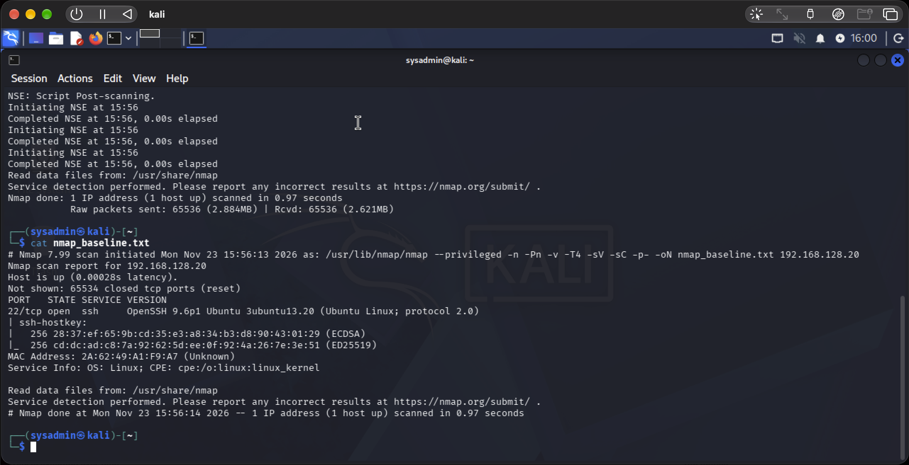

2. **Multi-Threaded SSH Password Guessing (`THC-Hydra` / `MITRE T1110.001`)**
   - Launched a 4-thread `THC-Hydra` dictionary attack (`hydra -l sysadmin -P passwords.txt -t 4 ssh://192.168.128.20`) executing 15 rapid authentication attempts within 13 seconds.
   - Verified real-time SIEM correlation in Wazuh: individual failed logins triggered **Rule Level 5** (*Password Guessing*), while the burst rate crossed Wazuh's correlation threshold to fire **Rule Level 10** (*Brute Force*) alerts mapped to **Credential Access** and **Lateral Movement**.

   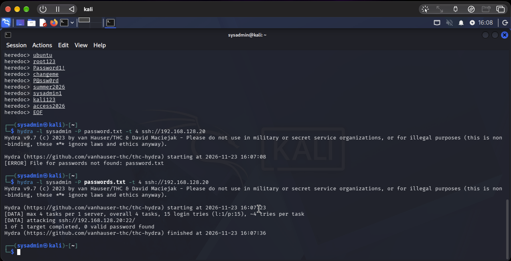

   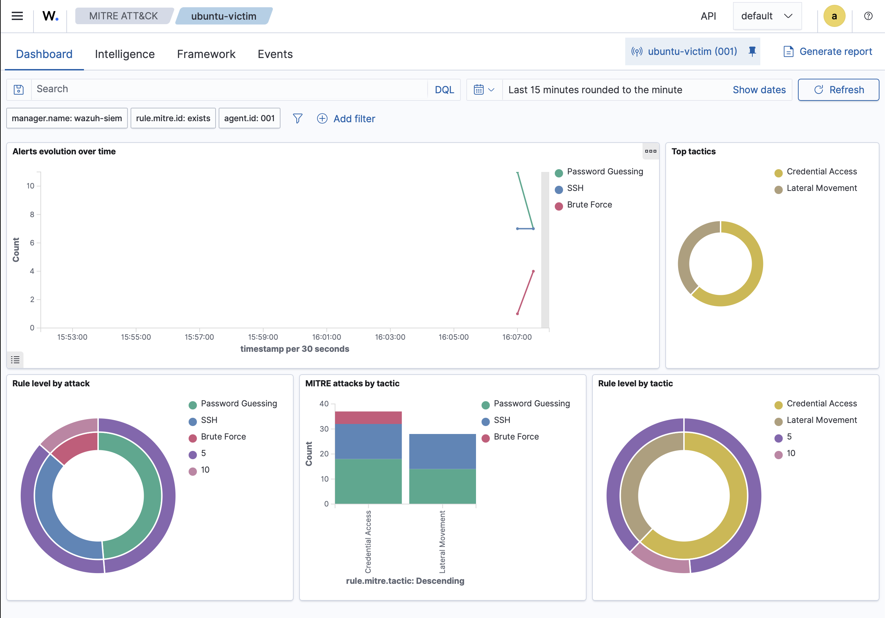

---

### Phase 2: Automated Incident Response & Active Containment (`firewall-drop`)

1. **Active Response Policy & Management Whitelisting (`ossec.conf`)**
   - Configured Wazuh Manager (`wazuh-siem`) to trigger the built-in `firewall-drop` Active Response script (`<location>local</location>`, `<timeout>600</timeout>`) upon detecting high-severity SSH brute-force correlation alerts (**Rule `5763`** and **Rule `2502`**, Level 10).
   - Added explicit `<white_list>` exclusions for the host management gateway (`192.168.128.1`) and SIEM server (`192.168.128.10`) to prevent accidental administrative lockout during automated remediation.

   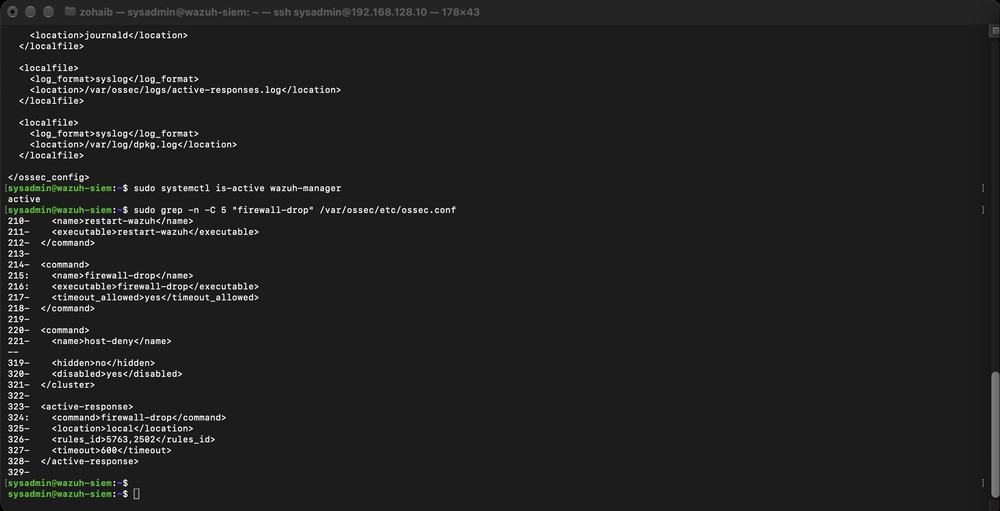

2. **Sub-Second `iptables` Kernel Containment & Attacker Isolation**
   - Re-executed the 4-thread `THC-Hydra` brute-force burst from `kali` (`192.168.128.30`). Upon hitting the 8-failure correlation threshold (`Rule 5763`), `wazuh-execd` invoked `active-response/bin/firewall-drop` within 1 second, dynamically injecting a kernel-level `DROP` rule into `ubuntu-victim`'s `INPUT` chain.
   - Verified containment from both endpoints: `ubuntu-victim` logged live dropped packets via `iptables -L INPUT -n -v` and `active-responses.log`, while `kali`'s remaining Hydra threads timed out (stretching execution from `13s` to `41s`) and subsequent ICMP probes suffered `100% packet loss`.

   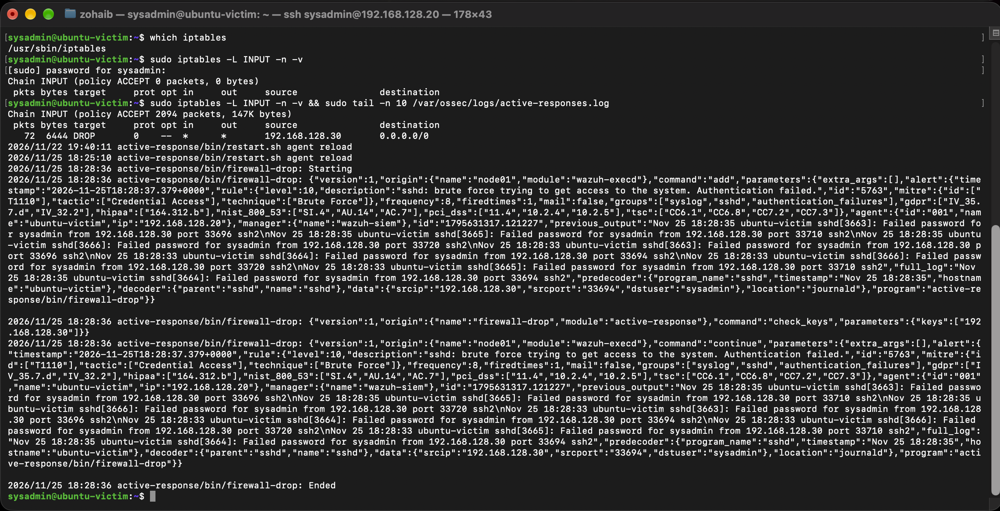

   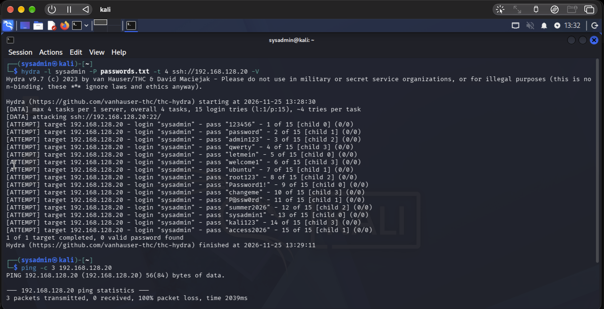

---

### Phase 2B: Purple Team Defense Evasion & Custom Detection Engineering (`Rule 100100`)

To validate defense-in-depth beyond default out-of-the-box signatures, two adversary evasion drills (`MITRE T1090` / `T1110.003`) were executed against the active `firewall-drop` containment policy:

1. **Drill 1 — Source IP Alias Rotation (`MITRE T1090`)**
   - While `192.168.128.30` was actively shunned in `ubuntu-victim`'s `iptables` `INPUT` chain, a secondary IP alias (`192.168.128.31/24`) was bound to `kali`'s `eth0` interface (`ip addr add`) and forced via `ssh -b 192.168.128.31`.
   - **Finding:** Because `firewall-drop` enforces single-IP (`data.srcip`) containment, rotating to `.31` immediately bypassed the block (`0%` ICMP packet loss and full SSH prompt access)—demonstrating why IP blacklisting is temporary containment that must be paired with key-based SSH hardening (`PasswordAuthentication no`).

   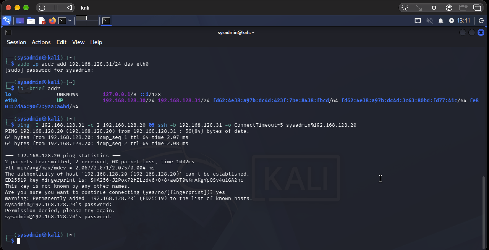

2. **Drill 2 — Low-and-Slow Password Spraying & Threshold Evasion (`MITRE T1110.003`)**
   - Wazuh's default `Rule 5763` requires `8` failed authentication events within `120` seconds to escalate to Level 10. Running `THC-Hydra` single-threaded with a 22-second inter-attempt delay (`hydra -l sysadmin -P spray.txt -t 1 -W 22`) completed all `6` guesses (`3.00 tries/min`) without triggering `Rule 5763` or `firewall-drop`, leaving `ubuntu-victim`'s `INPUT` chain completely open (`policy ACCEPT`).

   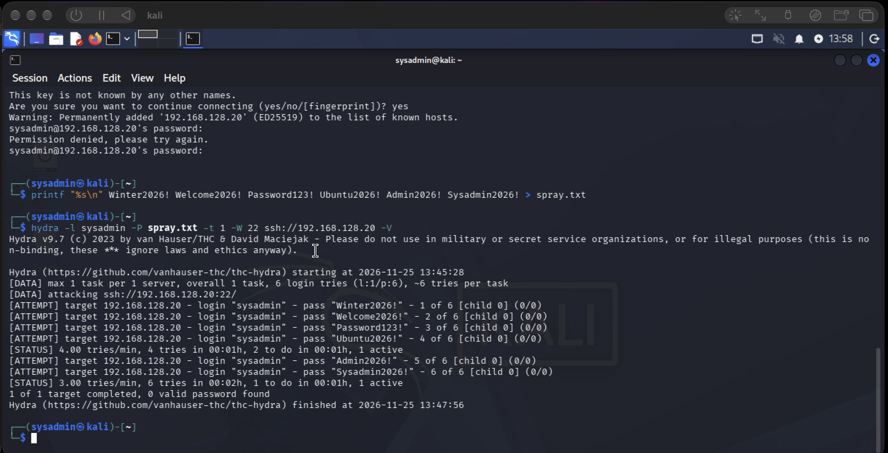

   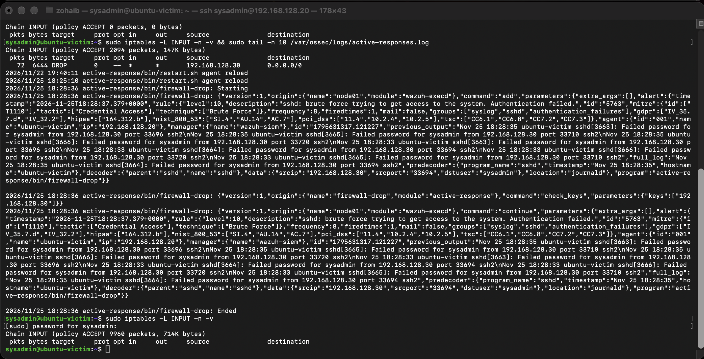

3. **Custom Detection Rule Engineering (`Rule 100100`) & Responsible AI Disclosure**
   - To close the low-and-slow correlation blind spot, custom **Rule `100100`** (Level `10`, `frequency="5"`, `timeframe="300"`, mapped to `MITRE T1110.003`) was authored in `/var/ossec/etc/rules/local_rules.xml` and wired into `ossec.conf`'s `firewall-drop` `<rules_id>` list.
   - **Responsible AI Usage Note:** The XML logic and correlation thresholds for `Rule 100100` were generated with **Google Gemini** to address the specific threshold-evasion requirements identified during this Purple Team lab exercise. All AI-generated rule syntax, MITRE ATT&CK mappings, and Active Response bindings were human-reviewed, scoped exclusively to the isolated lab environment (`192.168.128.0/24`), and empirically validated before deployment.
   - **Verification:** Re-running the identical 22-second-paced Hydra spray triggered `Rule 100100` on attempt #5 (`19:02:48 UTC`), automatically injecting a kernel `DROP` rule on `ubuntu-victim` and trapping Hydra attempt #6 in a `[RE-ATTEMPT]` timeout loop.

   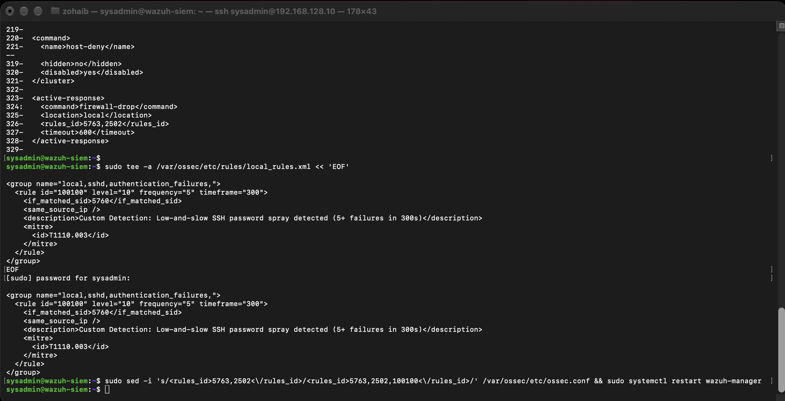

   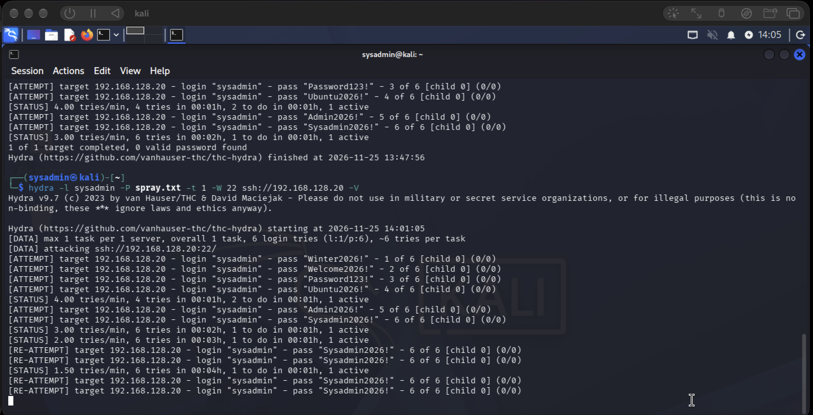

   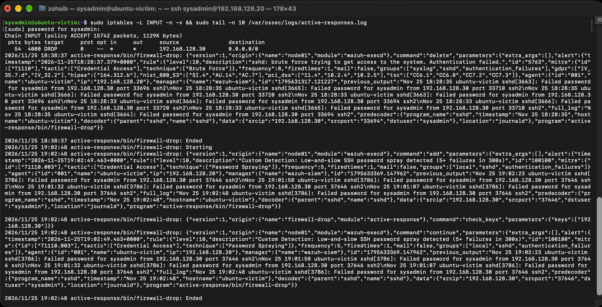

   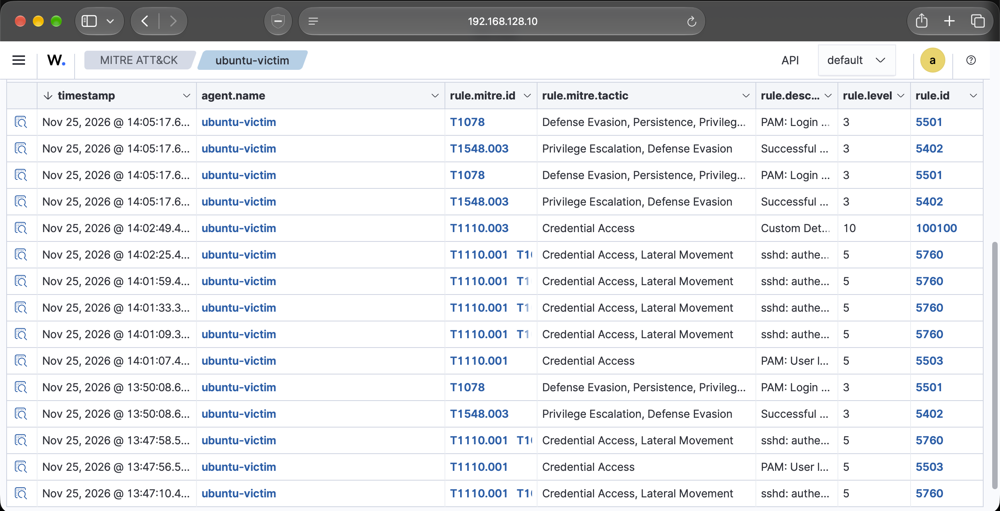

---

## Upcoming Phases

- **Phase 3:** Real-Time File Integrity Monitoring (`Syscheck` + `auditd`/`MITRE T1565.001`)
- **Phase 4:** Custom XML Detection Rule Engineering & Privilege Escalation (`MITRE T1548.003`)